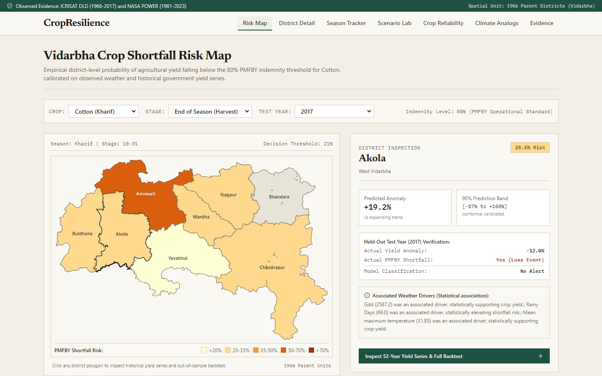

# VarhadCrop

District-level crop shortfall risk and climate stress-testing for Vidarbha, Maharashtra, built on real government yield statistics and observed weather, with uncertainty calibrated against held-out years.



---

## 1. Mission and Audience

VarhadCrop is designed for:
- **District Agriculture Officers (DAOs)** planning contingency interventions for delayed monsoon onset or prolonged dry spells.
- **Crop Insurance (PMFBY) Planners** assessing district-level area shortfall probabilities against official 80% indemnity thresholds.
- **Agri-Lenders & FPO Advisors** evaluating downside yield volatility across candidate crops.
- **Agricultural Climate Researchers** benchmarking machine learning models against rigorous historical baselines.

The platform answers four concrete operational questions:
1. **Shortfall Likelihood:** How likely is an agricultural yield shortfall below the 80% PMFBY indemnity threshold for crop C in district D, and how early in the season can we know?
2. **Climate Stress Sensitivity:** How much does that shortfall risk increase under warmer or drier conditions, and where does the model stop being trustworthy (out-of-distribution guard)?
3. **Crop Reliability:** Which crop is the most resilient against downside losses in this district, with uncertainty on the ranking?
4. **Climate Analogs:** Which district in Maharashtra today has a seasonal climate resembling the one this district will have under a given shift, and what crops dominate there?

---

## 2. Key Differences from Typical Yield Demos

- **Real Observed Data:** Grounded in 52 years of official yield statistics (ICRISAT District Level Database, 1966-2017) and 43 years of daily observed agroclimatology (NASA POWER, 1981-2023). Zero synthetic data in production.
- **Decision-Relevant Target:** Models the shortfall against official PMFBY-style moving-average threshold yields, not next-year point yield R2.
- **Season-Aware Features:** Formulates intra-seasonal dry spells, extreme heat days (Tmax >= 35, 38, 40 C), growing degree days, and Hargreaves PET within crop-specific calendar windows.
- **Calibrated Uncertainty:** Evaluates prediction intervals using Conformalized Quantile Regression (CQR) with empirical test coverage reported on held-out years.
- **Extrapolation Guards:** The scenario engine includes a multivariate Mahalanobis and univariate envelope out-of-distribution (OOD) guard that flags when perturbations leave the observed historical envelope.
- **Honest Evaluation:** Where weather models do not beat the historical trend baseline, the system explicitly reports "Exposure and sensitivity only".

---

## 3. Quickstart & Run Instructions

### Windows PowerShell

```powershell
# 1. Navigate to project root
cd D:\Projects\BioTech-AI

# 2. Set up Python virtual environment
python -m venv venv
.\venv\Scripts\Activate.ps1
pip install -r requirements.txt
pip install -e .

# 3. Start the Flask backend server (port 5000)
python -m backend.app

# 4. In a separate PowerShell window, launch the frontend (port 5173)
cd frontend
npm ci
npm run dev
```

Open `http://localhost:5173` in your browser.

---

### Linux / macOS Bash

```bash
# 1. Navigate to project root
cd /path/to/BioTech-AI

# 2. Set up Python virtual environment
python3 -m venv venv
source venv/bin/activate
pip install -r requirements.txt
pip install -e .

# 3. Start the Flask backend server (port 5000)
python3 -m backend.app

# 4. In a separate terminal window, launch the frontend (port 5173)
cd frontend
npm ci
npm run dev
```

Open `http://localhost:5173` in your browser.

---

## 4. Rebuilding Data & Models from Scratch

The entire data harmonization, feature engineering, model training, conformal calibration, and documentation generation pipeline can be rebuilt using one master command:

```bash
python -m scripts.build_all
```

This single command executes:
1. `scripts/download_yield_data.py`: Verifies and harmonizes ICRISAT DLD panel.
2. `scripts/download_weather_data.py`: Fetches and validates NASA POWER daily weather.
3. `scripts/prepare_boundaries.py`: Generates simplified GeoJSON boundaries for 1966 parent districts.
4. `cropres.features.builder`: Computes expanding trends, PMFBY thresholds, and season weather features.
5. `cropres.models.train`: Trains monotone-constrained LightGBM and calibrated classifier models.
6. `cropres.models.evaluate`: Evaluates rolling-origin held-out backtest and writes `artifacts/metrics.json`.
7. `scripts.generate_model_docs`: Generates `docs/EXPERIMENT_REPORT.md` and `docs/MODEL_CARD.md`.

---

## 5. Empirical Evaluation Results

Evaluated strictly on 10 held-out test years (2008-2017) across 507 test instances:

| Model / Protocol | Out-of-Sample Metric | Baseline Comparison | Finding |
| :--- | :--- | :--- | :--- |
| **Baseline A** | RMSE: 0.4401 | 0.0% | Zero relative anomaly (trend only). |
| **LightGBM (Monotone)** | RMSE: 0.4194 | **+4.69% Skill** [CI: +1.0%, +7.5%] | Weather alone explains 4.7% variance over trend. |
| **Panel Ridge** | RMSE: 0.4044 | **+8.11% Skill** [CI: +2.8%, +11.8%] | Regularized linear panels generalize well. |
| **Shortfall Classifier** | PR-AUC: 0.4628 | Base Prevalence: 36.69% | Calibrated threshold = 0.21, Precision = 49.3%. |
| **90% Conformal Band** | Coverage: 77.12% | Target: 90.0% | Cotton (90%), Wheat (92.5%), Soybean (62.5%). |

---

## 6. Testing & Quality Verification

Run the comprehensive test suites:

```bash
# Python unit, leakage, scenario, and contract tests (35 tests)
pytest -v

# Design rule compliance (no em dashes, no purple gradients, no hardcoded IPs)
python scripts/check_design_rules.py

# Frontend linting and type-checking
cd frontend
npm run lint
npm run build
```

---

## 7. Known Limitations

- **Aggregated Spatial Resolution:** Evaluated at 1966 parent district level (Akola, Amravati, Buldhana, Yavatmal, Wardha, Nagpur, Bhandara, Chandrapur). Does not predict individual farm-level yields without local soil tests and field management records.
- **Statistical Association:** Models capture empirical statistical correlations between weather variables and reported yield anomalies. They do not simulate physiological plant processes.
- **Tree Extrapolation:** LightGBM trees cannot extrapolate outside observed training feature ranges. When stress scenarios push weather outside the historical envelope, the OOD guard warns the user and widens prediction intervals.
